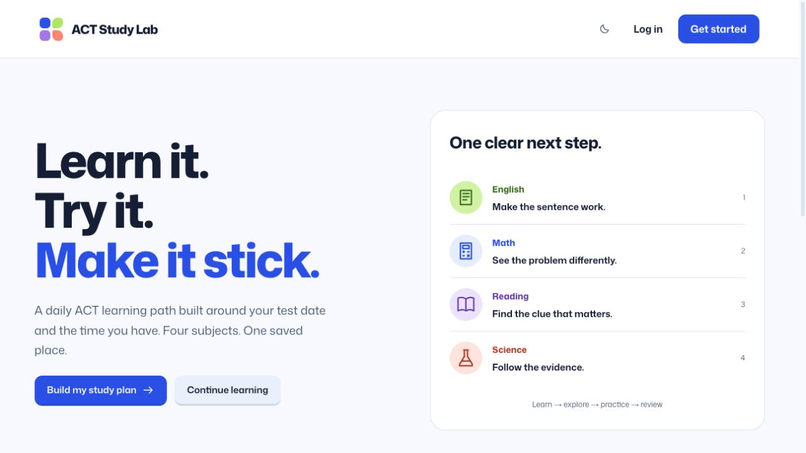
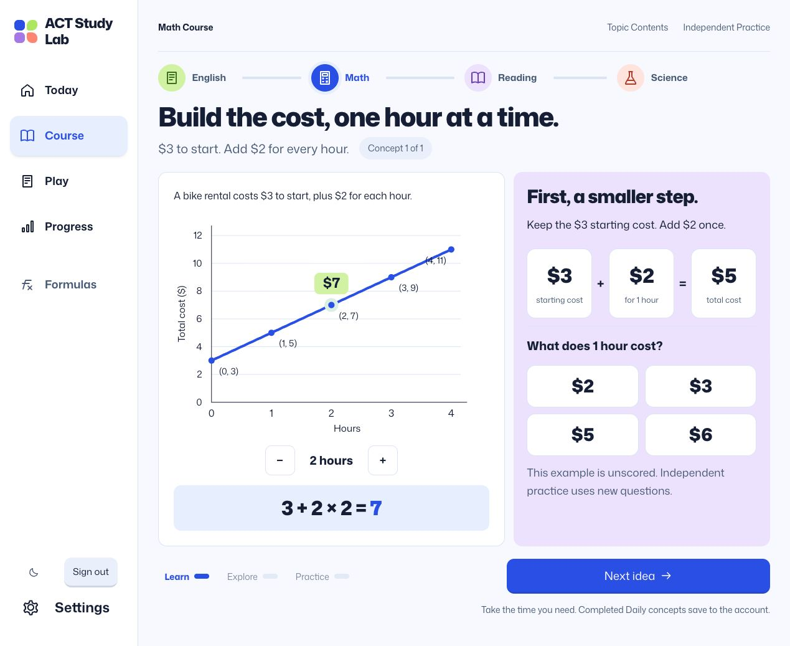
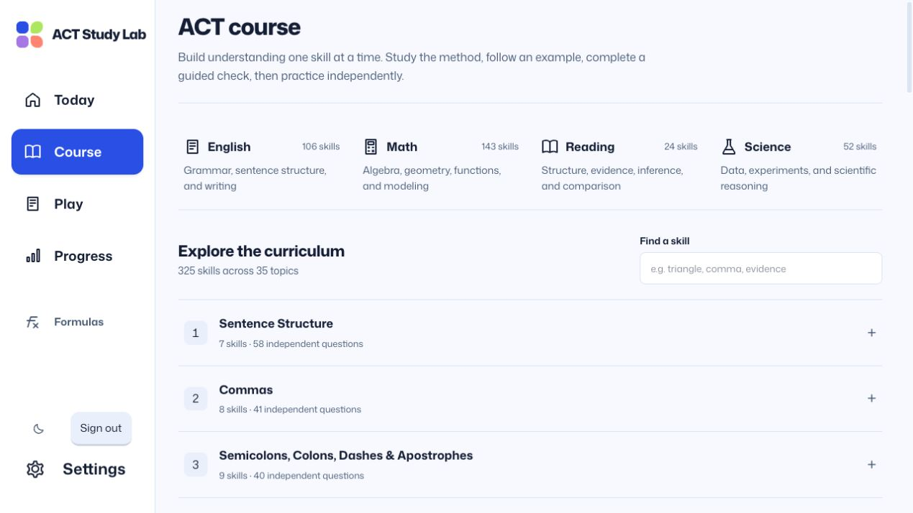

# ACT Study Lab

### Learn it. Try it. Make it stick.

A daily ACT learning path built around your test date and the time you have.

English, Math, Reading, and Science. One saved place.

Use it in your browser. Create an account. Start learning.

[Explore the app](https://act-study-lab.nikhorner.chatgpt.site) · [Report a bug](https://github.com/Nik-Horner/act-study-lab/issues) · [Contribute](CONTRIBUTING.md)

## Understand the idea. Then put it to work.

Study with visual explanations, worked examples, and guided checks before moving into independent practice. When you miss a question, follow the reasoning, try a smaller step, and return to fresh practice.

Your lessons, saved answers, and unfinished sessions stay with your account.

From the live app: explore a cost model, then work through a smaller step.

## Four subjects, one learning path

**English** — See how clauses, punctuation, and word choices fit together.

**Math** — Connect equations, graphs, and geometry through worked steps.

**Reading** — Find evidence and test what a passage actually supports.

**Science** — Explore data, compare experiments, and change one variable.

Choose your study time and test date. Follow the daily path or explore the course by subject. Revisit mistakes, practice formula recall, and check your pacing with timed sections. Science is optional in daily study.

<strong>Explore the course</strong> — 325 skills across 35 topics

## Start with the app

**[Build your study plan →](https://act-study-lab.nikhorner.chatgpt.site/signup)**

Already studying? [Continue where you left off](https://act-study-lab.nikhorner.chatgpt.site/login).

## Open source, open to contributions

ACT Study Lab is available under the [MIT license](LICENSE). Explore the code, report a problem, or help improve the experience.

[Contributor setup](CONTRIBUTING.md) · [Engineering notes](docs/engineering-notes.md) · [Design system](DESIGN.md)

Built with Next.js, React, TypeScript, Tailwind CSS, Supabase, and KaTeX.

---

Independent study material, not affiliated with or endorsed by ACT. Practice accuracy is not an official score prediction or a score guarantee.

Built by [Nik Horner](https://github.com/Nik-Horner).
