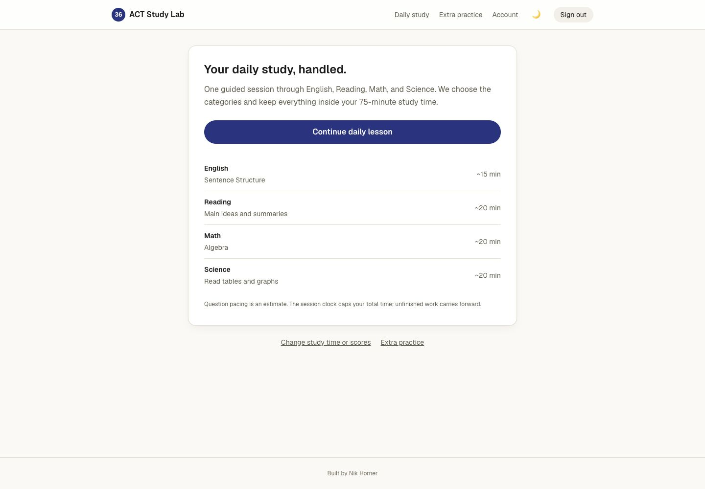
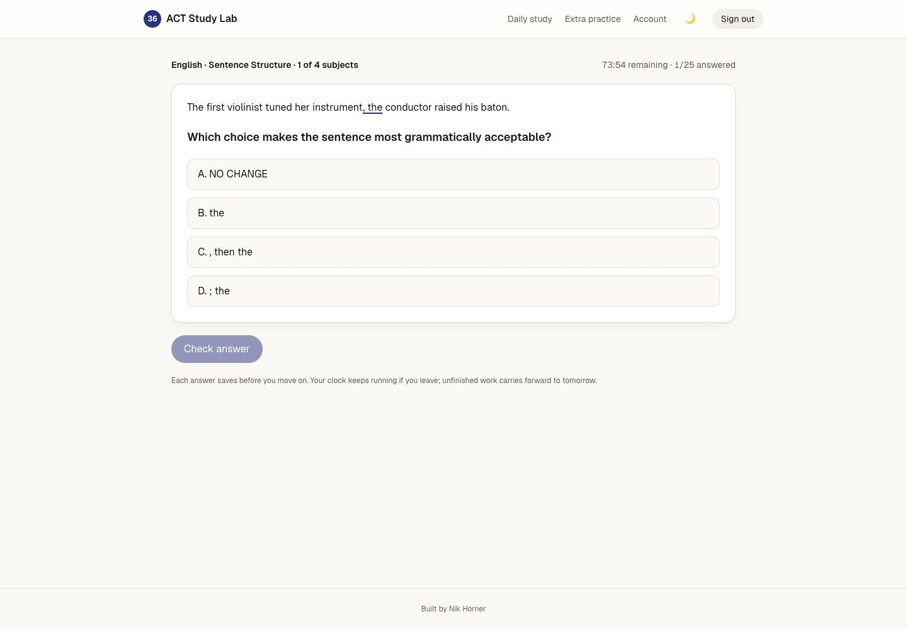
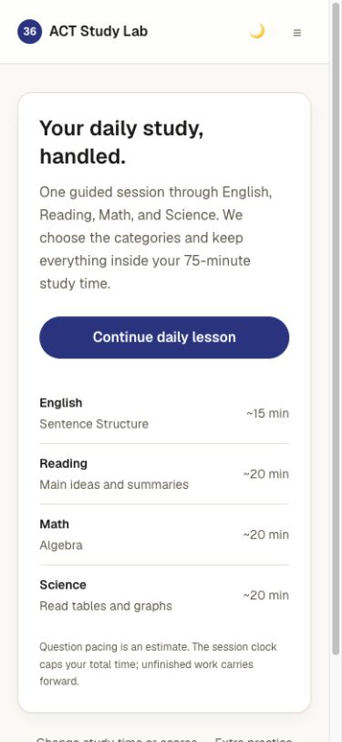

<div align="center">

# ACT Study Lab

### Four subjects. One daily study habit.

English, Math, Reading, and optional Science — with guided lessons, focused practice, and progress that follows your account.

[](https://github.com/Nik-Horner/act-study-lab/actions/workflows/check.yml)


[What’s inside](#whats-inside) · [Run locally](#run-locally) · [Development](#development) · [Project notes](#project-notes)

</div>



## A clear next step, every day

Set your test date, target scores, and daily study time. ACT Study Lab builds a guided session across your subjects: learn the method, work through an example, then try it yourself. Return to unfinished work without losing your place.

## What’s inside

- **Guided daily study.** Account-based plans use your goals, available time, and recorded weaknesses. Science is optional in daily study.
- **Lessons that show the work.** Grammar explanations, typeset math, Reading evidence, Science tables and diagrams, and interactive prediction activities.
- **Practice with feedback.** Topic drills explain answers and bring missed or uncertain skills back for review.
- **Timed sections.** Two original practice forms per subject: English (50 questions / 35 minutes), Math (45 / 50), Reading (36 / 40), and Science (40 / 40).
- **Formula recall.** An 80-card Math deck with topic filters and test-date pacing.
- **Saved progress.** Lessons, answers, and completed results sync to your account. Active timed sections recover on the current device with their original deadline.
- **Study on your screen.** Responsive layouts, keyboard controls, and light and dark themes.

<p align="center">
  
</p>

<details>
<summary><strong>See the mobile study view</strong></summary>
<br />
<p align="center">
  
</p>
</details>

## Run locally

Use **Node.js 22** and npm, plus a Supabase project for authentication and saved progress.

```bash
git clone https://github.com/Nik-Horner/act-study-lab.git
cd act-study-lab
npm ci
```

Create `.env.local` in the project root:

```dotenv
NEXT_PUBLIC_SUPABASE_URL=https://YOUR_PROJECT.supabase.co
NEXT_PUBLIC_SUPABASE_ANON_KEY=YOUR_PUBLIC_ANON_KEY
```

For a **new Supabase project**, run the SQL files in [`supabase/migrations`](supabase/migrations) in filename order. They create the profile, progress, and exam tables with owner-only row-level security. Enable email/password authentication and allow `http://localhost:3000/auth/callback` in the Auth redirect URLs. If email confirmation is enabled, confirm your email before signing in.

Use the public anon key here; never put a service-role key in a `NEXT_PUBLIC_` variable. `.env.local` is ignored by Git. Existing installations should retain their database and apply only migrations they have not run.

```bash
npm run dev
```

Open [localhost:3000](http://localhost:3000), create an account, and choose your study goals.

## Development

```bash
npm run lint              # ESLint
npm run validate:content  # Content and curriculum checks
npm test                  # Unit and regression tests
npm run build:next        # Native Next.js production build
npm run check             # Lint, content checks, tests, and Worker build
```

The default `npm run build` targets the Vinext/Cloudflare Worker deployment and requires both public Supabase variables at build time. For native Next.js, use `npm run build:next`, then `npm start`. Vercel selects the native build through `vercel.json`.

Live-account integration tests are separate from the default suite. See the [engineering notes](docs/engineering-notes.md) before running them.

```text
src/app/          Pages and API routes
src/components/   Lessons, study runners, diagrams, and shared UI
src/content/      Authored lessons, questions, activities, and exams
src/lib/          Planning, grading, progress, and Supabase clients
supabase/         Database migrations and access policies
tests/            Unit, regression, and explicit integration tests
docs/             Review notes and screenshots
```

## Project notes

Built with Next.js, React, TypeScript, Tailwind CSS, Supabase, and KaTeX. Worker hosting uses Vinext, Vite, and Cloudflare.

- [Engineering and deployment notes](docs/engineering-notes.md)
- [Design system](DESIGN.md)
- [Quality review and known limits](docs/quality-repair-2026-10-14.md)
- [Daily teaching review](docs/teaching-repair-2026-10-15.md)

Practice questions are independently authored. Results report raw accuracy, not an official ACT scaled-score prediction or a score guarantee. Use official timed forms for independent score checks. ACT Study Lab is not affiliated with or endorsed by ACT.

---

<p align="center">Built by <a href="https://github.com/Nik-Horner">Nik Horner</a></p>
